# BLACKBEARVN

### 🎮 GODOT GAME DEVELOPER

**Building worlds. Creating gameplay. Making ideas playable.**

 

`GAMEPLAY` · `PROTOTYPING` · `GAME SYSTEMS` · `GAME DESIGN`

 

---

## 👾 About Me

Hi! I'm **blackbearvn**.

I'm exploring game development with **Godot Engine**, creating prototypes, experimenting with gameplay mechanics, and learning by building playable experiences.

My goal is to turn creative ideas into fun and memorable games.

## 🕹️ Game Development

| Area | Exploring |
|:---|:---|
| 🎮 Godot Engine | Scenes, Nodes, Signals, Resources |
| ⚙️ Gameplay | Player movement, controls, interactions |
| 🧩 Game Systems | Inventory, combat, progression, saving |
| 🤖 Game AI | NPC behavior, state machines |
| 🌍 Game Design | Levels, mechanics, balancing |
| ✨ Game Feel | Animation, feedback, camera, polish |

## 🚀 Projects

I'm working on game ideas and prototypes using Godot.

**Explore my repositories:**

New projects will be featured here as they become ready to share.

## 📚 Currently Learning

- Building reusable gameplay systems in Godot
- Organizing scenes and reusable components
- Improving gameplay logic and architecture
- Prototyping and playtesting game ideas

## 📊 GitHub Statistics

  Statistics generated automatically with GitHub Actions.

---

### 💜 BUILD · PLAY · ITERATE

*Made with Godot and curiosity.*

